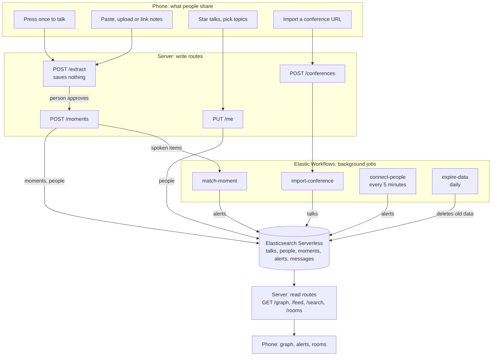

# Architecture outline

## Current MVP direction (supersedes conflicting sections below)

The agreed MVP is **ConFellow** — a native Flutter app for Android and iOS (with no web target or preview) centered on **"Find my wavelength"** in a high-contrast dark constellation style built for bright conference halls.

- **Single-speaker notes, not conversation recording:** One attendee speaks (transcribed on-device to text) or types/pastes their own text notes — text is the only supported data type, with no file uploads in the UI. Because notes capture a single speaker's own thoughts rather than multi-party conversations, there is no multi-person consent prompt. Voice capture retains the three-minute limit, stops when backgrounded, never writes audio to disk, and centers the listening UI around a live waveform while on-device Whisper (`ggml-large-v3-turbo-q5_0.bin` via `whisper.cpp`) is evaluated on phone hardware.
- **Phone session as profile (no onboarding or login gate):** Each phone generates and persists an opaque local session identifier (`owner_id`) that acts directly as the attendee's profile — no accounts, emails, passwords, or initial onboarding wall. Attendees land straight on the main experience, where selecting topics/talks from the bundled KubeCon North America schedule asset (retaining title, abstract, times, room, and tags, with speaker names omitted) or capturing notes immediately shapes their profile in Elasticsearch.
- **Realtime private saving and separate note submission:** After explicit opt-in, spoken partial transcripts upload privately through the attendee-authenticated transcript API, with a durable retry queue and a final revision when recording stops. The radar UI preserves this behavior from `main`. When a note finishes, a compact card displays matched schedule topics (for example, `Tuned: eBPF, kernel security`, or `Note saved` when no schedule tag matches — never invented topics) with an **Undo** window for wavelength tuning and optional note sharing. A device-saved **Review before sending** setting (off by default) switches that submission card to explicit **Send** or **Discard**. Those actions do not cancel or delete already authorized private transcript uploads. Typed notes still use the review/Undo flow; they are not sent by the realtime recording queue.
- **Privacy on search and discovery:** Every sent note participates in semantic matching, **but other attendees see only matched topics and why it matched in words — never a note's text unless the author explicitly chose "Share this note."** Both backend search endpoints and the single Flutter backend seam must omit note text unless explicitly shared.
- **Map and Space UX rules:** The UI refers to **notes** (never *conversations*), never displays match percentages (closeness is communicated spatially on concentric rings around the user with gentle drift), and never claims physical location (*nearby*). Tapping a Space opens a discovery sheet first — explaining in words why it is on your wavelength, showing talk room and time with an **I'm going** toggle, showing attendee counts rather than handles until someone enters a room, and listing recent topics — while `/rooms` text chat stays behind a feature flag as a stretch goal.
- **Backend boundary and secrets:** Flutter communicates only through one Dart backend interface configured solely with the HTTPS backend origin (`API_BASE_URL`), never shipping Elasticsearch credentials in the client. The FastAPI vector backend (`docs/vector-backend.md`) and `server/elastic` store handle embeddings and retention on the server.
- The backend also exposes attendee profiles, approved one-line moments, the topic graph, conference search and personal alerts. These use the `people`, `moments`, `talks` and `alerts` indices with their own attendee tokens. See [the attendee API](attendee-api.md) and [the realtime transcript contract](transcript-api.md).

The original hackathon sketch below remains as historical backend context; its mobile-web-only and no-native-app scope no longer describes the chosen frontend.

The implemented backend schema replaces the historical `moments` schema for conversation discovery. The topic graph, conference imports, profiles, alerts, rooms, and Elastic Workflows below remain future work. The backend container deploys through GitHub Actions and Argo CD to the `grindset` vcluster; the earlier Next.js/kind/cloudflared description is historical.

Working sketch for our Cloud Native Hackathon project (Elasticsearch track). Expect it to change as we build.

Submissions close at 5:30 PM MT. Aim to freeze code at 5:00.

## The idea

Conference attendees tell the app what they care about: the talks on their schedule, topics from the program, things they say with a press of a button, and notes they paste, upload or link. The app turns that into a live topic graph and connects people with shared interests, in person or in rooms.

## Ground rules

- **No passive listening.** The app only hears someone who pressed the button. If another person joins a recording, they agree on their own phone. About a dozen US states require every participant's consent, so we use this one rule everywhere. (Not legal advice.)
- **Nothing is shared until the person approves it.**
- **We keep summaries, not sources, unless the owner opts in.** Audio, note files and page contents are discarded. Transcript text is stored only after opt-in, stays private by default, and reaches other attendees only when its owner shares a finalized segment after confirming everyone recorded agreed.
- **Elasticsearch is the only datastore.**
- **Handles, not accounts.** No emails or passwords.

## Overview

- **Phone:** a mobile web app opened from a QR code. No native app today.
- **Server:** one thin Next.js container for anything a person is waiting on. It runs on kind, with `cloudflared` providing HTTPS, which the browser mic requires.
- **Elastic Workflows:** everything that runs in the background.
- **Elasticsearch Serverless:** storage, search and Jina embeddings through `semantic_text`.

## Input pipeline

Every input becomes text, then follows the same path.

1. **To text:** text transcribed on the phone passes straight through. Audio goes to cloud transcription, which is one swappable function. `.md` and `.txt` files are read as text, and links go through Jina Reader. Originals are discarded.
2. **Extract:** an LLM returns up to five items, each a one-line gist plus topics. It reuses existing topic names so `eBPF` and `ebpf` don't split into two nodes.
3. **Approve:** the person edits, removes or shares each item.
4. **Publish:** items go into `moments` and the person's `interests`. Only spoken items alert other people, so a long upload can't spam everyone.
5. **Read:** the phone polls for graph data, alerts and chat every few seconds.

The talk button is press once to start and again to stop, with a visible recording state and a 3-minute limit.

## What links people

| Signal | Comes from | Good for |
|---|---|---|
| Schedule | Starring talks from the imported program | Same room, same time: the strongest in-person signal |
| Interests | Picking topics from the scraped program | People following the same subjects |
| Talking | Press once, talk, approve the summary | Live matches by meaning |
| Notes | Paste, upload or link, then approve | Matches by meaning, with no alerts |

Rooms do the linking, in person and online. Every talk and topic gets one (`talk:<id>` or `topic:<name>`). An alert says "three people who care about eBPF are going to this talk, join its room", so nobody's schedule is exposed unless they choose to enter.

## Data

| Index | Main fields | Used for |
|---|---|---|
| `talks` | conference, title, abstract, content (semantic_text), topics, start, end, room, speakers | Program and starting graph |
| `people` | conference, handle, token_hash, interests (semantic_text), topics, starred_talks, last_active | Recommendations |
| `moments` | conference, handle, source, gist (semantic_text), topics, at | Live graph activity |
| `alerts` | conference, to_handle, kind, room, why, at, seen | Notifications |
| `messages` | conference, room, handle, text, at | Chat |

## Server routes

| Route | Job |
|---|---|
| `PUT /me` | Opt in, or update handle, interests, topics and starred talks |
| `DELETE /me` | Erase this person's data |
| `POST /extract` | Turn audio, text, a file or a URL into proposed items, saving nothing |
| `POST /moments` | Publish approved items, and start `match-moment` for spoken ones |
| `POST /conferences` | Check `robots.txt`, then start `import-conference` |
| `GET /graph` | Topics as nodes, co-occurrence as edges |
| `GET /feed` | My alerts |
| `GET /search` | Hybrid search by text or topic |
| `GET`, `POST /rooms/:room` | Text chat |

## Workflows

| Workflow | Runs | Does |
|---|---|---|
| `import-conference` | When someone submits a URL, then hourly | Reader fetches the page, `ai.prompt` extracts sessions and topics, `elasticsearch.bulk` writes `talks` |
| `match-moment` | Started by the server after each spoken item | Searches `people`, writes `alerts` |
| `connect-people` | Every 5 minutes | Matches on schedule and interests, flags talks starting soon, writes `alerts` |
| `expire-data` | Daily | Deletes people, moments and messages after the conference ends |

Workflows has no documented trigger for new documents, so the server starts `match-moment` through the run API. Alerts need stable IDs so reruns can't send duplicates.

## Search

- **Recommendations and alerts:** one search on `people` with three named clauses: shared talks, shared topics, and a semantic `match` on interests. Use a minimum score, tuned with test sentences. Don't use RRF here, because its scores only reflect rank and can't show that the best match is still a poor one. Elasticsearch reports which clauses matched, which gives us the "why" for each alert.
- **Search box and topic pages:** RRF over keyword and semantic results from `talks` and `moments`.
- **Graph:** a `terms` aggregation on `topics` with a nested `terms` for topics that appear together. Talks give the base shape, and the last 30 minutes of moments show what's active. Rendered with `react-force-graph-2d`.

## Scraping a conference

- **Any conference:** Jina Reader plus `ai.prompt`, split by day. Public pages only, and respect `robots.txt`.
- **KubeCon:** Reader keeps titles, times, rooms, speakers and tags, but drops the abstracts, which the site hides in the page. Load the 553 abstracts from the raw page with one small script.

## Security

- **Keys:** kept on the server and in Kibana connectors, never in the repo or workflow YAML. `.env` must be added to `.gitignore` before anyone creates one.
- **Limits:** cap clip length and upload size, and rate-limit each token.
- **Hostile text:** notes and web pages can contain instructions aimed at the LLM. It may only return the fixed gist-and-topics shape, which the server validates. User text is never pasted into a `query_string`.
- **Links:** only Jina Reader fetches them, and only public `https` URLs are accepted.
- **Moderation:** run gists and chat through a moderation check, because a QR code on a projector invites abuse.
- **Pen test:** run against our own deployed URL only.

## Not today

Voice Spaces (add through a hosted service last, and don't transcribe them), real push notifications, a native app, and speaker identification. Opt-in attendee location is covered in [geospatial presence](geospatial.md).

## Build order

1. Elastic project, indices, load talks.
2. Typed notes through `/extract` and `/moments`.
3. `/graph` and the graph screen.
4. Talk button, `match-moment` and `/feed`.
5. Rooms.
6. `import-conference` and `connect-people`.
7. Container, kind, HTTPS link and security pass.

## Still to confirm

- Workflows is available on our trial, and the `http` and `elasticsearch.bulk` steps exist.
- Which LLMs our trial includes (`GET _inference/_all`).
- How quickly a workflow starts through the API, which decides whether `match-moment` feels live.
- How quickly new documents become searchable.
- Whether scraping the KubeCon schedule is fine with the organizers.

## Submission checklist

- Public repo, with `.env` and other secrets kept out.
- README with setup steps.
- Disclosure of the AI tools we used.
- Everyone can explain the architecture and technical decisions.

## Implemented Elastic database

The Elastic project now has `conversations` plus the five historical indices above.
The Node.js conversation adapter supports full transcript revisions and typed-interest
semantic search. See [Elasticsearch setup](elasticsearch.md) for the pinned Jina model,
setup commands, and live validation of that existing schema. The public FastAPI
`GET /querysession` endpoint searches only its synthetic fixture in `conversations`.

The authenticated FastAPI vector API uses a separately provisioned
`conversation-garden-conversations` alias with its own schema, revision protection,
and retention cleanup. See [the vector backend contract](vector-backend.md).
It does not consume the Node.js adapter or migrate the existing indices.
Flutter private recording ingestion uses the separate attendee-authenticated
`/transcripts` routes backed by the existing `conversations` index. The radar's
local schedule profile and optional live discovery adapter remain separate from
the secure private-transcript session; this conflict resolution does not migrate
their identities. Flutter demo search continues to use `/querysession`.

*Drafted with Claude Code.*
