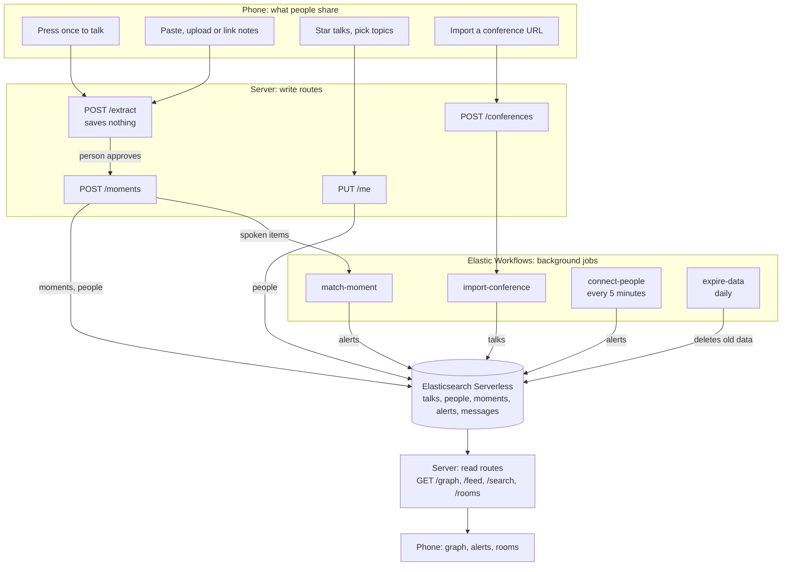

# Architecture outline

Working sketch for our Cloud Native Hackathon project (Elasticsearch track). Expect it to change as we build.

Submissions close at 5:30 PM MT. Aim to freeze code at 5:00.

## The idea

Conference attendees tell the app what they care about: the talks on their schedule, topics from the program, things they say with a press of a button, and notes they paste, upload or link. The app turns that into a live topic graph and connects people with shared interests, in person or in rooms.

## Ground rules

- **No passive listening.** The app only hears someone who pressed the button. If another person joins a recording, they agree on their own phone. About a dozen US states require every participant's consent, so we use this one rule everywhere. (Not legal advice.)
- **Nothing is shared until the person approves it.**
- **We keep summaries, not sources.** Audio, transcripts, note files and page contents are discarded. We store only approved one-line gists and topics.
- **Elasticsearch is the only datastore.**
- **Handles, not accounts.** No emails or passwords.

## Overview

- **Phone:** a mobile web app opened from a QR code. No native app today.
- **Server:** one thin Next.js container for anything a person is waiting on. It runs on kind, with `cloudflared` providing HTTPS, which the browser mic requires.
- **Elastic Workflows:** everything that runs in the background.
- **Elasticsearch Serverless:** storage, search and Jina embeddings through `semantic_text`.

## Input pipeline

Every input becomes text, then follows the same path.

1. **To text:** text transcribed on the phone passes straight through. Audio goes to cloud transcription, which is one swappable function. `.md` and `.txt` files are read as text, and links go through Jina Reader. Originals are discarded.
2. **Extract:** an LLM returns up to five items, each a one-line gist plus topics. It reuses existing topic names so `eBPF` and `ebpf` don't split into two nodes.
3. **Approve:** the person edits, removes or shares each item.
4. **Publish:** items go into `moments` and the person's `interests`. Only spoken items alert other people, so a long upload can't spam everyone.
5. **Read:** the phone polls for graph data, alerts and chat every few seconds.

The talk button is press once to start and again to stop, with a visible recording state and a 3-minute limit.

## What links people

| Signal | Comes from | Good for |
|---|---|---|
| Schedule | Starring talks from the imported program | Same room, same time: the strongest in-person signal |
| Interests | Picking topics from the scraped program | People following the same subjects |
| Talking | Press once, talk, approve the summary | Live matches by meaning |
| Notes | Paste, upload or link, then approve | Matches by meaning, with no alerts |

Rooms do the linking, in person and online. Every talk and topic gets one (`talk:<id>` or `topic:<name>`). An alert says "three people who care about eBPF are going to this talk, join its room", so nobody's schedule is exposed unless they choose to enter.

## Data

| Index | Main fields | Used for |
|---|---|---|
| `talks` | conference, title, abstract, content (semantic_text), topics, start, end, room, speakers | Program and starting graph |
| `people` | conference, handle, token_hash, interests (semantic_text), topics, starred_talks, last_active | Recommendations |
| `moments` | conference, handle, source, gist (semantic_text), topics, at | Live graph activity |
| `alerts` | conference, to_handle, kind, room, why, at, seen | Notifications |
| `messages` | conference, room, handle, text, at | Chat |

## Server routes

| Route | Job |
|---|---|
| `PUT /me` | Opt in, or update handle, interests, topics and starred talks |
| `DELETE /me` | Erase this person's data |
| `POST /extract` | Turn audio, text, a file or a URL into proposed items, saving nothing |
| `POST /moments` | Publish approved items, and start `match-moment` for spoken ones |
| `POST /conferences` | Check `robots.txt`, then start `import-conference` |
| `GET /graph` | Topics as nodes, co-occurrence as edges |
| `GET /feed` | My alerts |
| `GET /search` | Hybrid search by text or topic |
| `GET`, `POST /rooms/:room` | Text chat |

## Workflows

| Workflow | Runs | Does |
|---|---|---|
| `import-conference` | When someone submits a URL, then hourly | Reader fetches the page, `ai.prompt` extracts sessions and topics, `elasticsearch.bulk` writes `talks` |
| `match-moment` | Started by the server after each spoken item | Searches `people`, writes `alerts` |
| `connect-people` | Every 5 minutes | Matches on schedule and interests, flags talks starting soon, writes `alerts` |
| `expire-data` | Daily | Deletes people, moments and messages after the conference ends |

Workflows has no documented trigger for new documents, so the server starts `match-moment` through the run API. Alerts need stable IDs so reruns can't send duplicates.

## Search

- **Recommendations and alerts:** one search on `people` with three named clauses: shared talks, shared topics, and a semantic `match` on interests. Use a minimum score, tuned with test sentences. Don't use RRF here, because its scores only reflect rank and can't show that the best match is still a poor one. Elasticsearch reports which clauses matched, which gives us the "why" for each alert.
- **Search box and topic pages:** RRF over keyword and semantic results from `talks` and `moments`.
- **Graph:** a `terms` aggregation on `topics` with a nested `terms` for topics that appear together. Talks give the base shape, and the last 30 minutes of moments show what's active. Rendered with `react-force-graph-2d`.

## Scraping a conference

- **Any conference:** Jina Reader plus `ai.prompt`, split by day. Public pages only, and respect `robots.txt`.
- **KubeCon:** Reader keeps titles, times, rooms, speakers and tags, but drops the abstracts, which the site hides in the page. Load the 553 abstracts from the raw page with one small script.

## Security

- **Keys:** kept on the server and in Kibana connectors, never in the repo or workflow YAML. `.env` must be added to `.gitignore` before anyone creates one.
- **Limits:** cap clip length and upload size, and rate-limit each token.
- **Hostile text:** notes and web pages can contain instructions aimed at the LLM. It may only return the fixed gist-and-topics shape, which the server validates. User text is never pasted into a `query_string`.
- **Links:** only Jina Reader fetches them, and only public `https` URLs are accepted.
- **Moderation:** run gists and chat through a moderation check, because a QR code on a projector invites abuse.
- **Pen test:** run against our own deployed URL only.

## Not today

Voice Spaces (add through a hosted service last, and don't transcribe them), real push notifications, a native app, location, and speaker identification.

## Build order

1. Elastic project, indices, load talks.
2. Typed notes through `/extract` and `/moments`.
3. `/graph` and the graph screen.
4. Talk button, `match-moment` and `/feed`.
5. Rooms.
6. `import-conference` and `connect-people`.
7. Container, kind, HTTPS link and security pass.

## Still to confirm

- Workflows is available on our trial, and the `http` and `elasticsearch.bulk` steps exist.
- Which LLMs our trial includes (`GET _inference/_all`).
- How quickly a workflow starts through the API, which decides whether `match-moment` feels live.
- How quickly new documents become searchable.
- Whether scraping the KubeCon schedule is fine with the organizers.

## Submission checklist

- Public repo, with `.env` and other secrets kept out.
- README with setup steps.
- Disclosure of the AI tools we used.
- Everyone can explain the architecture and technical decisions.

*Drafted with Claude Code.*
