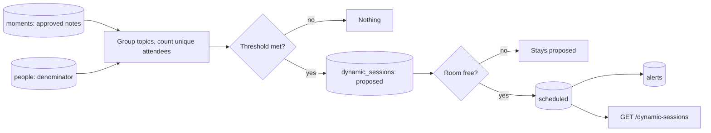

# Dynamic sessions

When enough attendees discuss the same topic, the backend proposes a discussion session, books a designated room if one is free, and publishes it to the app.



A Kubernetes CronJob runs this every five minutes.

## How a session is triggered

- Only the `moments` index is read for activity, which holds notes the attendee approved. Private transcripts in `conversations` are never read.
- Attendees are counted once per topic, using exact unique handles. Labels are grouped, so `Kubernetes Autoscaling`, `kubernetes auto-scaling`, `K8s autoscaling` and small typos count as one topic. Grouping is keyword-based; semantic clustering is not used.
- A topic triggers when it has at least `MIN_UNIQUE_ATTENDEES` people and either:
  - at least `ABSOLUTE_THRESHOLD` people, or
  - at least `PERCENT_THRESHOLD` of that conference's unexpired `people` profiles.
- If the attendee count is unavailable, only the absolute rule applies.

## Rooms and scheduling

- A room must be `designated`, in the same conference, large enough for the unique attendee count, and open for the whole slot. Automatic scheduling also requires `auto_schedule_authorized`.
- Slots start on a grid of the session duration in the room's timezone, at least `LEAD_MINUTES` ahead and within `HORIZON_MINUTES`. The earliest slot wins, then the smallest room that fits.
- A slot is skipped if it overlaps a talk or another scheduled dynamic session in that room.
- If nothing qualifies, the proposal stays `proposed` with a `pending_reason` of `no_designated_room`, `insufficient_capacity` or `no_available_slot`, and later runs retry it.

Each session has an ID derived from conference, topic and cooldown period, and each room slot has its own lock document. Both are written with `op_type=create`, and the status change uses sequence-number checks. Overlapping runs therefore cannot create duplicates or double-book a room.

## Setup

Run these before merging. Until the index exists the CronJob logs `not_provisioned` and exits successfully.

1. **Create the index.** In Kibana Dev Tools, run `PUT /dynamic_sessions` with the contents of `backend/mappings/dynamic-sessions.json` as the body.
2. **Check the API key** in `confellow-elastic`. It needs `read`, `write` and `view_index_metadata` on `dynamic_sessions`, `read` on `moments`, `people` and `talks`, and `write` on `alerts`.
3. **Add rooms.** Add one document per room, for example:

```text
PUT /dynamic_sessions/_doc/room-cnh-dynamic-room-a
{
  "record_type": "room",
  "conference": "cnh",
  "room_id": "dynamic-room-a",
  "room": "Dynamic Room A",
  "capacity": 60,
  "designated": true,
  "auto_schedule_authorized": true,
  "timezone": "America/Denver",
  "available_windows": [{"start": "2026-11-10T08:00:00", "end": "2026-11-10T18:00:00"}],
  "accessibility": "Step-free access, hearing loop",
  "demo": false
}
```

Times without an offset use the room's `timezone`. If no organizer inventory exists, use the synthetic rooms below, which are marked `"demo": true`.

4. **Optional: enable the admin endpoints.** Create a Secret named `dynamic-sessions-admin` in `team-grindset`, through Radar and never in git, with key `DYNAMIC_SESSIONS_ADMIN_TOKEN` holding a random value of at least 32 characters. Then restart the `app` Deployment. Without it, those endpoints return 503.

## Configuration

Set in `deploy/dynamic-sessions-config.yaml`, used by both the CronJob and the API:

| Variable | Default | Meaning |
| --- | --- | --- |
| `DYNAMIC_SESSIONS_WINDOW_MINUTES` | 30 | How far back to count activity |
| `DYNAMIC_SESSIONS_PERCENT_THRESHOLD` | 5 | Percentage of eligible attendees |
| `DYNAMIC_SESSIONS_ABSOLUTE_THRESHOLD` | 50 | Unique attendees |
| `DYNAMIC_SESSIONS_MIN_UNIQUE_ATTENDEES` | 3 | Floor for small conferences |
| `DYNAMIC_SESSIONS_DURATION_MINUTES` | 30 | Session length and slot grid |
| `DYNAMIC_SESSIONS_LEAD_MINUTES` | 15 | Minimum notice before start |
| `DYNAMIC_SESSIONS_HORIZON_MINUTES` | 240 | How far ahead to look for a slot |
| `DYNAMIC_SESSIONS_COOLDOWN_MINUTES` | 120 | Gap before a topic can trigger again |
| `DYNAMIC_SESSIONS_MAX_NEW_PER_RUN` | 3 | New sessions per conference per run |

## API for the frontend

`GET` routes need the attendee token (`Authorization: Bearer <token>` from `PUT /me`). Only `scheduled` sessions are returned, and times include the conference's UTC offset.

### GET /dynamic-sessions

Query: `conference` (required, must match the token's conference), `upcoming` (default `true`), `limit` (1-100, default 50). Sessions are sorted by start time.

```json
{
  "sessions": [
    {
      "id": "ds-3f2a9c1e",
      "type": "dynamic",
      "conference": "cnh",
      "title": "Kubernetes Autoscaling Discussion",
      "description": "A spontaneous discussion organized around common attendee interests",
      "topic": "Kubernetes Autoscaling",
      "topics": ["K8s autoscaling", "Kubernetes Autoscaling"],
      "attendee_count": 55,
      "attendee_percentage": 11.0,
      "start": "2026-11-10T15:30:00-07:00",
      "end": "2026-11-10T16:00:00-07:00",
      "timezone": "America/Denver",
      "duration_minutes": 30,
      "room": "Dynamic Room A",
      "room_id": "dynamic-room-a",
      "capacity": 60,
      "accessibility": "Step-free access, hearing loop",
      "status": "scheduled",
      "demo": false,
      "created_at": "2026-11-10T15:10:00+00:00",
      "expires_at": "2026-11-11T16:00:00-07:00"
    }
  ]
}
```

`attendee_percentage` and `accessibility` are absent when unknown. `demo: true` means the room is synthetic.

### GET /dynamic-sessions/{session_id}

Returns one session in the same format. Returns 404 for an unknown session, a pending proposal, or another conference.

Errors follow `docs/attendee-api.md`: 401, 403, 422, and 503 to retry later.

Confirmed sessions also create `alerts` with `kind: "dynamic_session"`, which `GET /feed` already returns.

### Administrator routes

These need `Authorization: Bearer <DYNAMIC_SESSIONS_ADMIN_TOKEN>` and are never for the app.

- `POST /dynamic-sessions/run` with optional `{"conference": "cnh", "dry_run": true}` runs one evaluation and returns the decision summary.
- `POST /dynamic-sessions/{session_id}/approve` with `{"room_id": "dynamic-room-a"}` schedules a pending proposal. The room must be designated, but need not be authorized for automatic scheduling.

## Inspecting runs in Radar

In Radar Cloud, open the `grindset` cluster, then **CronJobs**, then `dynamic-sessions` in `team-grindset`. Each run is a Job, and its log is one JSON line with a decision per triggered topic. An agent can use `manage_cronjob` with `action: trigger` to run it now, and `get_workload_logs` with `kind: job` to read the result. Failed runs exit non-zero, so they appear as failed Jobs.

Traces are in Dash0 under service `confellow-dynamic-sessions`: span `dynamic_sessions.run` with `dynamic_session.decision` events. These hold topic labels and counts only, never handles or note text.

## Demonstration

Seed synthetic data (55 fictional attendees and two rooms marked `demo`), in a terminal with `ELASTICSEARCH_URL` and `ELASTICSEARCH_API_KEY` set:

```bash
python -m backend.dynamic_sessions.job seed-demo --conference demo-kubecon
```

The notes expire after two hours. To appear in the app, which uses conference `cnh`, seed that conference with `--conference cnh --allow-non-demo-conference`; this puts synthetic notes into real graph and search results until they expire.

Then trigger the `dynamic-sessions` CronJob in Radar, read the Job log, and call `GET /dynamic-sessions` with an attendee token for that conference. Expect `Kubernetes Autoscaling Discussion` in `Dynamic Room A`.

## Limits

- `cancelled` is a supported status and counts toward the cooldown, but there is no cancel endpoint yet.
- Expired records are hidden but not deleted.
- A note tagged with two separate topics counts toward both, so it can trigger two sessions.
